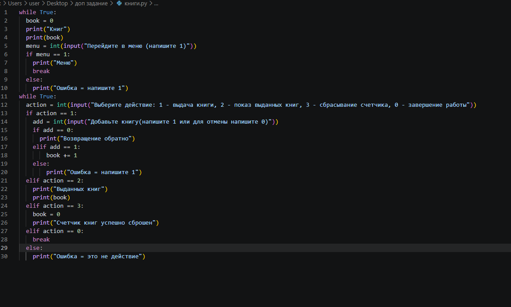
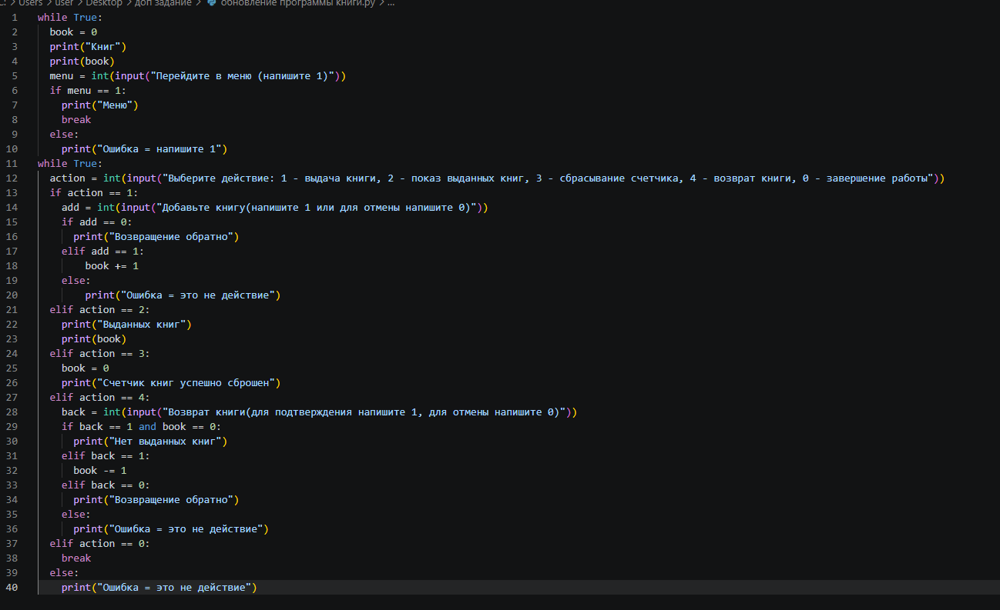

## Программа "Учёт книг"

## Версия 1

## Версия 2

## Описание
Программа Учёт книг предназначена для выдачи и возврат книг, есть функции выдачи, показа выданных книг, сбрасывание счетчика, возврат книг и завершение работы

## Требования
Python 3.15.2
Visual Studio Code

## Инструкция для запуска
1. Откройте файл книги(версия 1) или обновление программы книги(версия 2) в VS code
2. Нажать на кнопку Run

## Инструкция пользования
Чтобы перейти в меню напишите 1, дальше откроется меню с командами, выбирайте нужную(для команд 1 и 4(1 - подтвердить, 0 - отмена))